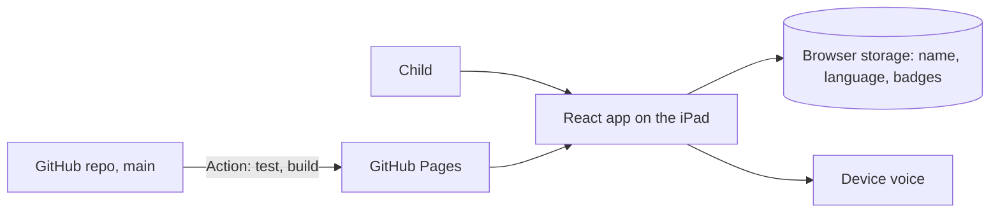

# Architecture

Update this file in the same pull request as any structural change.

## Big picture



## Components

- **App** (`src/App.tsx`): holds progress state (language, name, age group, disabled lessons, badges) and the current screen (name, map, lesson, parents, facts, timeline).
- **Progress** (`src/progress.ts`): pure functions for badges, next lesson, disabled lessons, age group, storage and the save code. Tested in `src/progress.test.ts`.
- **Lessons registry** (`src/lessons.ts`): the ordered lesson list and curriculum groups with ids and titles in EN, DE, and PL. Ids are saved in progress and in the save code, so only append new ids, never reorder or rename.
- **UI text** (`src/i18n.ts`): all interface strings in EN, DE, and PL.
- **Lesson engine** (`src/lesson/`): `types.ts` (the `Lesson` shape), `LessonRunner.tsx` (story, toy, quiz, badge, real life, Ask Dad), `toolkit.tsx` (Stage, Slider, ToyButton, CheckButton, `animatedBeat`). A story beat is either an old emoji `scene` or an animated beat: one Otto line per tap and a diagram that shows one more part per tap.
- **Lesson content** (`src/content/<id>.tsx`, registry in `src/content/index.ts`): one file per lesson, checked by `src/content/content.test.ts`. Supports dual content forks for Junior (7-10) and Senior (10-14) with transparent fallback to junior. How to write one: [docs/writing-lessons.md](docs/writing-lessons.md). Parents read each lesson's fact card in the app (gear icon, maths gate, Fact cards).
- **Screens and pieces** (`src/components/`): `Otto`, `SpeechBubble` (highlights _term_ words), `icons.tsx` (flat SVG icons and villagers, drawn in code), `diagram.tsx` (canvas, pop-in, arrows, bubbles, term chip), `LangSwitch` (global 3-way language toggle), `NameScreen`, `MapScreen`, `ParentPanel`, `FactCards`, `LessonPlaceholder`.
- **World timeline** (`src/timeline/`, `src/components/TimelineScreen.tsx`): static event data (7 eras, 6 tracks: India, Europe, Americas, East Asia, Africa and Middle East, Science) with trilingual titles and Junior and Senior summaries. Opened from the globe button on the map header. Events can name a `lessonId` they relate to. Group 5 lessons also get a "Meanwhile around the world" card (`src/timeline/meanwhile.ts`, `src/components/MeanwhileCard.tsx`) shown after the real life card: a year slider over a per-lesson window, one latest event per track, Junior or Senior text. Each event shown is also appended to the lesson's fact card with a source. Tested in `src/timeline/timeline.test.ts` and `src/components/TimelineScreen.test.tsx`.
- **Sound and speech** (`src/sound.ts`, `src/speech.ts`): synthesized effects and read-aloud.
- **Offline** (`public/sw.js`): caches app files after the first visit.

## Key decisions

See [docs/design.md](docs/design.md) and [docs/adr](docs/adr).

How work moves from an issue to the live site (agents, review, gate, deploy): [docs/factory.md](docs/factory.md). The factory is specified, not yet built.

## How to run and test

```bash
npm install
npm run dev
npm test
npm run build
```
