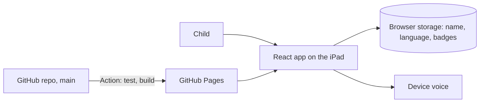

# Architecture

Update this file in the same pull request as any structural change.

## Big picture



## Components

- **App** (`src/App.tsx`): holds progress state and the current screen (name, map, lesson, parents).
- **Progress** (`src/progress.ts`): pure functions for badges, next lesson, storage and the save code. Tested in `src/progress.test.ts`.
- **Lessons registry** (`src/lessons.ts`): the ordered lesson list with ids and titles in EN and DE. Ids are saved in progress and in the save code, so only append new ids, never reorder or rename.
- **UI text** (`src/i18n.ts`): all interface strings in EN and DE.
- **Screens and pieces** (`src/components/`): `Otto`, `SpeechBubble`, `NameScreen`, `MapScreen`, `ParentPanel`, `LessonPlaceholder`.
- **Sound and speech** (`src/sound.ts`, `src/speech.ts`): synthesized effects and read-aloud.
- **Offline** (`public/sw.js`): caches app files after the first visit.

## Key decisions

See [docs/design.md](docs/design.md) and [docs/adr](docs/adr).

## How to run and test

```bash
npm install
npm run dev
npm test
npm run build
```
